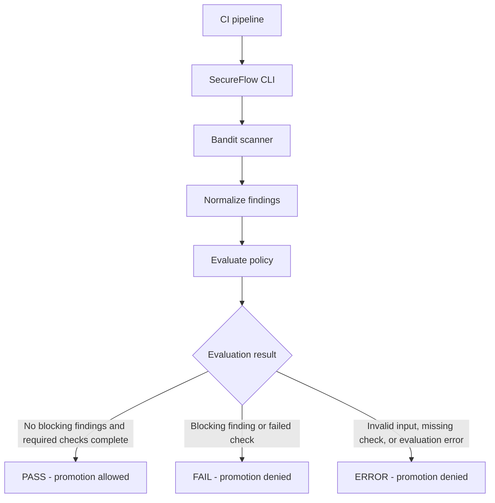

# SecureFlow

**A fail-closed security gate for CI/CD pipelines.**

SecureFlow scans Python code for security findings, normalizes the results, and evaluates them against a policy before allowing promotion. It is designed to make the pipeline decision explicit: pass when required checks complete without blocking findings, fail when security policy is violated, and return an error when the gate cannot reliably evaluate the scan.

> **Project status:** Active development. The current implementation integrates Bandit as its configured scanner. Review the limitations below before using SecureFlow to protect production deployments.

## Why SecureFlow?

A security scanner is most useful in CI/CD when its findings lead to a clear, enforceable decision. SecureFlow separates scanning from policy evaluation so a pipeline can distinguish a security failure from an execution or evaluation error.

Key capabilities:

- **Fail-closed policy evaluation:** missing required checks, invalid policy input, and evaluation errors do not produce a successful promotion decision.
- **Python security scanning:** integrates Bandit and normalizes scanner findings.
- **Structured results:** emits a JSON report containing the decision, check results, findings, and promotion status.
- **Pipeline-friendly exit codes:** supports automated enforcement in shell scripts and CI workflows.
- **Verification fixture:** includes intentionally vulnerable Python code to verify that the gate blocks a failing scan.
- **Reporting API:** provides an Express API and SQLite persistence for scan results.

## How the gate works



The CLI returns a structured report and a process exit code. CI should treat only a successful `PASS` as permission to continue.

| Decision | Exit code | Promotion |
|---|---:|---|
| `PASS` | `0` | Allowed |
| `FAIL` | `1` | Denied |
| `ERROR` | `2` | Denied |

The exact result depends on the checks and policy evaluated for the scan.

## Documentation

- **[Architecture](docs/architecture.md)** — explains SecureFlow's components, scan lifecycle, policy evaluation, and CI/CD integration.
- **[Threat Model](docs/threat-model.md)** — documents security assets, trust boundaries, threats, existing mitigations, and remaining risks.
- **[Demo Guide](docs/demo.md)** — provides step-by-step instructions for running tests, demonstrating a vulnerable scan being blocked, and verifying a safe scan.
- **[Architecture Decision Records](docs/decisions.md)** — explains key design decisions, including fail-closed enforcement, Bandit integration, exit codes, subprocess handling, the separation between enforcement and reporting, SQLite storage, and the handling of unverified API reports.

## Requirements

- Python 3.14
- Node.js 22 and npm, for the API tests and API development
- Git, to clone the repository

The Python dependencies are listed in `requirements.txt`. The API dependencies and scripts are defined in `api/package.json` and `api/package-lock.json`.

## Quick start

Clone the repository and enter the project directory:

```bash
git clone https://github.com/Igna73M/secureflow.git
cd secureflow
```

Create and activate a virtual environment:

```bash
python3.14 -m venv .venv
source .venv/bin/activate
```

Install the Python dependencies:

```bash
python -m pip install --upgrade pip
python -m pip install -r requirements.txt
```

Install the API dependencies:

```bash
cd api
npm ci
cd ..
```

Run the test suite and gate verification:

```bash
make test
make gate-test
```

Run the complete local CI command sequence:

```bash
make ci
```

`make ci` runs the Python tests, API tests, vulnerable-fixture gate verification, and a scan of the SecureFlow engine itself. A successful local run does not by itself establish that hosted GitHub Actions is working.

## Run a scan

Scan a directory with the SecureFlow CLI:

```bash
python -m engine.cli scan engine
```

The CLI writes a JSON report to standard output. Use the exit code to control pipeline execution:

```bash
python -m engine.cli scan engine > secureflow-report.json
scan_status=$?

case "$scan_status" in
  0)
    echo "Security gate passed"
    ;;
  1)
    echo "Security gate failed: blocking findings detected"
    exit 1
    ;;
  2)
    echo "Security gate error: evaluation could not be completed"
    exit 2
    ;;
  *)
    echo "Unexpected SecureFlow exit code: $scan_status"
    exit 2
    ;;
esac
```

This example uses the engine directory as the scan target. Replace `engine` with the project directory you intend to scan.

## Reproduce a blocked scan

SecureFlow includes a Bandit fixture intended to demonstrate a failing security gate.

Run:

```bash
python scripts/verify_gate.py
```

The verification script checks that the vulnerable fixture produces a `FAIL` decision, denies promotion, and includes at least one blocking finding. The command exits unsuccessfully if those expectations are not met.

You can also run the scanner directly against the fixture:

```bash
python -m engine.cli scan fixtures/bandit
```

A failing security scan is expected to return exit code `1`; this is different from an unexpected evaluation error, which returns `2`.

For a complete walkthrough, see [the demo instructions](docs/demo.md).

## API

The project also contains an Express API and a SQLite database for storing scan records. The API is a reporting and persistence component; the
