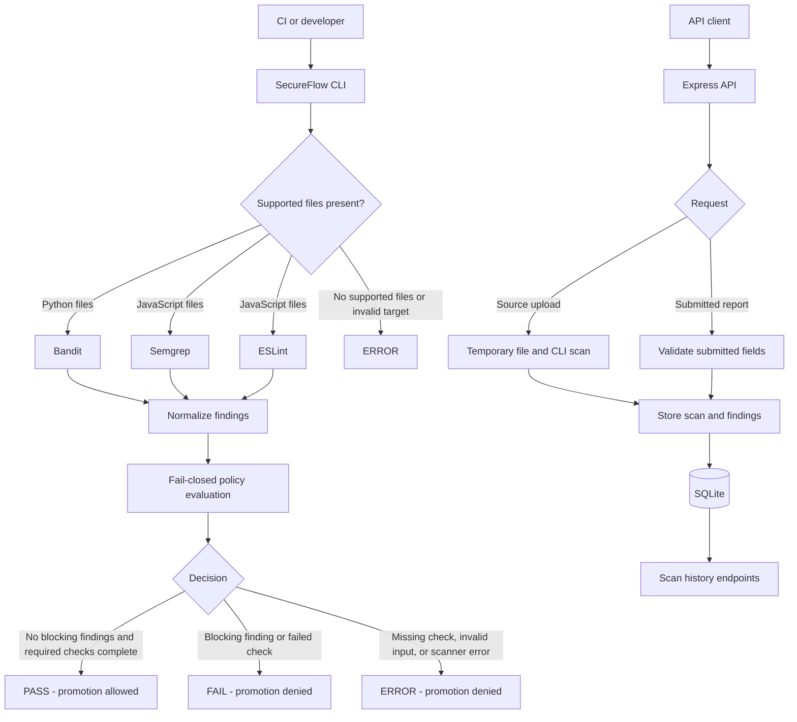

# SecureFlow

SecureFlow is a CI/CD security gate that scans supported Python and JavaScript files, normalizes scanner findings, and makes a fail-closed promotion decision. It also includes an Express API for scanning individual uploaded source files and for storing and retrieving scan records in SQLite.

> **Status:** Active development. Scanner coverage, policy rules, API trust, and operational controls are limited. Review [Security limitations](#security-limitations) before relying on SecureFlow in a production deployment.

## Contents

- [SecureFlow](#secureflow)
  - [Contents](#contents)
  - [Why SecureFlow](#why-secureflow)
  - [Features and scope](#features-and-scope)
  - [Architecture](#architecture)
  - [Gate decisions and CLI exit codes](#gate-decisions-and-cli-exit-codes)
  - [Requirements](#requirements)
  - [Installation](#installation)
  - [Scan a directory](#scan-a-directory)
  - [JSON report](#json-report)
  - [Demonstrate a blocked scan](#demonstrate-a-blocked-scan)
  - [Scanner behavior](#scanner-behavior)
    - [Python and Bandit](#python-and-bandit)
    - [JavaScript, Semgrep, and ESLint](#javascript-semgrep-and-eslint)
  - [API setup](#api-setup)
  - [API routes and request formats](#api-routes-and-request-formats)
  - [Source upload scanning](#source-upload-scanning)
  - [Scan history and SQLite](#scan-history-and-sqlite)
  - [Testing and local CI](#testing-and-local-ci)
  - [GitHub Actions](#github-actions)
  - [Repository layout](#repository-layout)
  - [Security limitations](#security-limitations)
  - [Documentation](#documentation)
  - [Contributing and license](#contributing-and-license)
  - [License](#license)

## Why SecureFlow

Scanner output is most useful in a pipeline when it produces a clear decision and an enforceable process status. SecureFlow separates scanner execution from policy evaluation so automation can distinguish blocking findings from an inability to complete a reliable assessment. Only `PASS` permits promotion; a scanner or evaluation error does not become a successful result.

## Features and scope

- Scans directories containing Python and/or JavaScript source files.
- Uses Bandit for Python, and Semgrep plus ESLint for JavaScript.
- Normalizes findings, assigns blocking status, and returns structured JSON.
- Returns distinct process exit codes for `PASS`, `FAIL`, and `ERROR`.
- Provides an Express API for individual-source uploads, submitted scan reports, health checks, and scan history.
- Persists API scan records and findings in SQLite.
- Includes intentionally vulnerable fixtures and automated tests for the gate and API.

SecureFlow is not a general-purpose vulnerability platform. Its configured scanner set and rules are narrow, and a clean result is not proof that code is free of vulnerabilities. The reporting API is separate from the CLI decision path; accepting a submitted report does not verify that the report came from a genuine scan.

## Architecture



For a directory with both Python and JavaScript files, all applicable scanners run and are required. The CLI does not automatically submit its scan report to the API. The API's `POST /api/scans` route only validates and stores a submitted report; it does not run a scanner or independently recompute the policy decision.

## Gate decisions and CLI exit codes

| Decision | Meaning | Promotion | Exit code |
|---|---|---|---:|
| `PASS` | Required checks completed without blocking findings or failed checks | Allowed | `0` |
| `FAIL` | A check failed or at least one finding is marked blocking | Denied | `1` |
| `ERROR` | The target, check results, or evaluation is invalid or incomplete | Denied | `2` |

The policy engine treats missing required checks, invalid check data, and checks with status `ERROR` as `ERROR`. Otherwise, blocking findings or a check with status `FAIL` produce `FAIL`; only the remaining valid case produces `PASS`. Findings are blocking by default at `CRITICAL` and `HIGH` severity; a scanner finding explicitly marked blocking remains blocking. Promotion is allowed exactly when the decision is `PASS`.

The CLI syntax is:

```bash
python -m engine.cli scan DIRECTORY
```

The target must be an existing directory containing at least one supported `.py`, `.js`, `.cjs`, or `.mjs` file. A missing target or a directory without supported files returns `ERROR` and exit code `2`.

## Requirements

- Python 3.14 (the version used by the repository's GitHub Actions workflow).
- Node.js 22 and npm for API development and API tests.
- Git to clone the repository.
- The Python packages in [`requirements.txt`](requirements.txt), including Bandit, pytest, and Semgrep.
- API packages installed from [`api/package-lock.json`](api/package-lock.json), including Express, `better-sqlite3`, and ESLint.

The JavaScript CLI checks require the API dependencies to be installed because SecureFlow invokes the ESLint binary in `api/node_modules/.bin`. The API source-upload route also requires the Python dependencies and scanner tools available in the runtime environment.

## Installation

Clone the repository and enter its directory:

```bash
git clone https://github.com/Igna73M/secureflow.git
cd secureflow
```

Create a Python virtual environment and install the Python dependencies:

```bash
python3.14 -m venv .venv
source .venv/bin/activate
python -m pip install --upgrade pip
python -m pip install -r requirements.txt
```

Install the API dependencies, which also makes the configured ESLint executable available:

```bash
cd api
npm ci
cd ..
```

Python-only scans need the Python dependencies. Scanning JavaScript directories also needs the API's npm dependencies for ESLint.

## Scan a directory

Scan the engine directory:

```bash
python -m engine.cli scan engine
```

Replace `engine` with the directory to scan. The CLI recursively finds supported file extensions. If the directory contains Python files it runs Bandit; if it contains JavaScript files it runs Semgrep and ESLint. It prints a JSON report to standard output and uses the decision-specific exit code above.

For a shell pipeline, preserve the process status while optionally saving the JSON report:

```bash
python -m engine.cli scan path/to/source > secureflow-report.json
scan_status=$?

case "$scan_status" in
  0) echo "Security gate passed" ;;
  1) echo "Security gate failed"; exit 1 ;;
  2) echo "Security gate could not complete"; exit 2 ;;
  *) echo "Unexpected SecureFlow exit code: $scan_status"; exit 2 ;;
esac
```

Only exit code `0` represents permission to continue. Treat `FAIL`, `ERROR`, and any unexpected exit code as denied promotion.

## JSON report

A completed directory scan returns a JSON object containing:

- `decision`: `PASS`, `FAIL`, or `ERROR`.
- `promotion_allowed`: `true` only for `PASS`.
- `errors`: evaluation or scanner error messages, if any.
- `checks`: the checks evaluated, with their names, statuses, and normalized findings.
- `blocking_findings`: findings that policy treats as promotion-blocking.
- `target`: the resolved target path for a valid directory scan.

Normalized findings include scanner and rule identifiers, severity, title, message, file and line information when safely available, and a `blocking` flag. File paths are kept relative to the scan root where possible; unsafe or unavailable paths may be `null`. API acceptance or storage does not mean the scan passed: API acceptance is a separate storage outcome.

## Demonstrate a blocked scan

The repository includes an intentionally vulnerable Python sample in [`fixtures/bandit/vulnerable_sample.py`](fixtures/bandit/vulnerable_sample.py). Run the verification script:

```bash
python scripts/verify_gate.py
```

The script scans `fixtures/bandit` and verifies that the CLI returns exit code `1`, the decision is `FAIL`, promotion is denied, and at least one finding is blocking. The script itself exits successfully when these expected conditions hold.

To inspect the scanner report directly, run:

```bash
python -m engine.cli scan fixtures/bandit
```

This scan is expected to return `FAIL` with exit code `1`; that is the intended fixture behavior. The repository also has JavaScript fixtures in [`fixtures/javascript`](fixtures/javascript), which can be scanned with the CLI after the Python and API dependencies are installed:

```bash
python -m engine.cli scan fixtures/javascript
```

## Scanner behavior

### Python and Bandit

The CLI runs Bandit recursively against a target directory containing Python files and requests JSON output. Bandit's exit code `1` is accepted as a report containing findings, not automatically treated as scanner failure. SecureFlow parses and normalizes that report before policy evaluation. Execution failures, invalid JSON, or Bandit-reported scan errors become check errors and therefore deny promotion.

### JavaScript, Semgrep, and ESLint

For `.js`, `.cjs`, and `.mjs` files, the CLI requires both Semgrep and ESLint checks. Semgrep uses the repository rules in [`rules/javascript-security.yml`](rules/javascript-security.yml), which currently include rules targeting `eval` and `exec`/`execSync` calls. ESLint runs with the project's explicit flat configuration at [`api/eslint.config.mjs`](api/eslint.config.mjs). Findings from both scanners are normalized and evaluated by the same policy engine. A failed or unavailable check does not count as a clean scan.

Although the Semgrep rules declare JavaScript and TypeScript languages, the CLI's target discovery currently includes only `.js`, `.cjs`, and `.mjs`; TypeScript files are not selected by the CLI.

## API setup

From the repository root, install dependencies as described above, then start the API:

```bash
cd api
npm start
```

The API listens on `127.0.0.1:3000` by default. `SECUREFLOW_HOST` can change the bind host and `PORT` can change the port; the port must be an integer from 1 through 65535. The process logs its listening URL. Stop it with `Ctrl+C`.

The API also serves the static files in [`dashboard`](dashboard) from its root URL. This is a static dashboard, not a React application.

The API has no authentication or authorization. Its default loopback binding reduces network exposure for local use, but changing the host can expose it. Do not expose it to untrusted users or networks without adding appropriate access controls.

## API routes and request formats

All API routes are defined in [`api/src/app.js`](api/src/app.js). JSON bodies are limited to 256 KiB; malformed JSON returns `400`, and an oversized request body returns `413`.

| Method and route | Behavior |
|---|---|
| `GET /health` | Returns `200` with `{"status":"ok"}` when SQLite is available; otherwise returns `503` with `{"status":"unavailable"}`. |
| `POST /api/scans` | Validates and stores a submitted scan report and its findings; returns `201` with `id`, `decision`, and `promotion_allowed`. This route does not run scanners. |
| `POST /api/scan-upload` | Scans one uploaded source file and stores the resulting report; returns `201` with the scan ID, target, decision, promotion flag, scanner errors, and findings when the scan result is valid. `FAIL` and `ERROR` scan decisions can still be returned with HTTP `201`, because the request was processed and recorded. |
| `GET /api/scans` | Lists newest scan records; returns `scans`. The optional `limit` defaults to `20` and must be an integer from `1` to `100`. |
| `GET /api/scans/:id` | Returns one scan with its findings; invalid IDs return `400`, and unknown IDs return `404`. |

`POST /api/scans` expects a JSON object with `target` (non-empty, at most 1,000 characters), `decision` (`PASS`, `FAIL`, or `ERROR`), `promotion_allowed` (boolean), and `findings` (array of at most 1,000 entries). The promotion flag must be `true` exactly for `PASS`. A `PASS` containing an explicitly blocking finding is rejected. Each finding must provide non-empty `scanner` (up to 100 characters), `rule_id` (up to 100), valid `severity` (`CRITICAL`, `HIGH`, `MEDIUM`, `LOW`, or `INFO`), `title` (up to 500), `message` (up to 2,000), and a boolean `blocking`. A supplied `file` may be `null` or a relative path of at most 500 characters; absolute paths, drive-prefixed paths, `..` path segments, and NUL characters are rejected. `line` may be omitted or `null`, otherwise it must be a positive integer. The API performs structural and consistency validation, not a full policy re-evaluation or source scan for this route.

Example report submission:

```bash
curl -i -X POST http://127.0.0.1:3000/api/scans \
  -H 'Content-Type: application/json' \
  -d '{
    "target": "demo-project",
    "decision": "FAIL",
    "promotion_allowed": false,
    "findings": [{
      "scanner": "bandit",
      "rule_id": "B602",
      "severity": "HIGH",
      "title": "Shell execution detected",
      "file": "src/example.py",
      "line": 12,
      "message": "Potential unsafe shell execution.",
      "blocking": true
    }]
  }'
```

This example submits data for storage; it is not a command to scan the named target.

## Source upload scanning

`POST /api/scan-upload` accepts a JSON object containing a `filename` and source `content` string. Supported filename extensions are `.py`, `.js`, `.cjs`, and `.mjs`. The filename must be non-empty and at most 255 characters; the UTF-8 content must be non-empty and no larger than 100 KiB. Unsupported extensions or invalid input return `400`; content exceeding the source limit returns `413`.

The API writes the source into a temporary directory, invokes `python -m engine.cli scan` against that directory, validates the scanner result, stores the scan and findings, and removes the temporary directory. The returned target uses the form `upload:<filename>`. A successfully processed upload returns HTTP `201` even when the scan decision is `FAIL` or `ERROR`; check `decision` and `promotion_allowed`, not just the HTTP status. The overall JSON request parser has its separate 256 KiB limit.

Example:

```bash
curl -i -X POST http://127.0.0.1:3000/api/scan-upload \
  -H 'Content-Type: application/json' \
  -d '{"filename":"example.py","content":"print(\"hello\")\n"}'
```

Python uploads are scanned with Bandit. JavaScript uploads run Semgrep and ESLint, so the API runtime must have both Python scanner dependencies and the API's npm dependencies installed. The environment variable `SECUREFLOW_PYTHON` can select the Python executable used by the upload route; the default is `python`.

## Scan history and SQLite

The API stores scan metadata in a `scans` table and associated normalized finding fields in a `findings` table. The scan and its findings are inserted in a transaction. Findings reference their scan, and SQLite foreign keys are enabled. The database also uses write-ahead logging and a 5-second busy timeout.

By default, the database file is `api/secureflow.db` (created when the API initializes). `SECUREFLOW_DB_PATH` can set a different database file path. `/api/scans` lists recent records with a bounded result count, while `/api/scans/:id` returns a record and its findings. The API does not add an authentication layer around these records, so filesystem protection and network isolation matter.

## Testing and local CI

The root [`Makefile`](Makefile) defines these commands:

```bash
make test-python
make test-api
make test
make gate-test
make scan-engine
make ci
```

- `make test-python` runs `python -m pytest -v`.
- `make test-api` runs `npm test` in `api`.
- `make test` runs both test targets.
- `make gate-test` runs `python scripts/verify_gate.py`.
- `make scan-engine` runs `python -m engine.cli scan engine` and propagates its exit status.
- `make ci` runs `test`, `gate-test`, and `scan-engine` in sequence.

The final engine scan can fail the make target if it returns `FAIL` or `ERROR`; inspect its decision and findings rather than assuming the local CI target always exits successfully.

## GitHub Actions

The workflow in [`.github/workflows/ci.yml`](.github/workflows/ci.yml) runs on pushes and pull requests targeting `main` or `master`. It uses Ubuntu, Python 3.14, and Node.js 22; installs the Python and API dependencies; runs `make test`; verifies that the vulnerable Python fixture returns `FAIL`; and scans the engine directory. The workflow has read-only `contents` permission, a 10-minute job timeout, and cancels superseded runs in the same concurrency group.

The workflow file describes configured checks, not their hosted-run status. No successful GitHub Actions execution is verified by this README task. A successful local run does not establish that hosted CI is working; check the repository's Actions runs separately.

## Repository layout

```text
.
├── api/                  Express API, SQLite access, tests, and ESLint config
├── dashboard/            Static dashboard served by the API
├── docs/                 Architecture, threat model, demo, and decisions
├── engine/               CLI, scanner adapters, normalization, and policy
├── fixtures/             Python and JavaScript scanner examples
├── rules/                Local Semgrep rules for JavaScript
├── scripts/              Gate verification script
├── tests/                Python test suite
├── .github/workflows/    GitHub Actions CI workflow
├── Makefile              Local test and CI targets
└── requirements.txt      Python dependencies
```

## Security limitations

- Scanner coverage is limited to Bandit, the configured Semgrep rules, and the project's ESLint configuration. Detection is not comprehensive, and TypeScript files are not currently included in CLI target discovery.
- API authentication and authorization are not implemented. Do not expose the API to untrusted users or networks.
- `POST /api/scans` accepts client-supplied decisions and does not scan source or recompute the complete policy result. The API's consistency checks do not establish report provenance or truth.
- The source-upload route scans one file at a time and imposes a 100 KiB source limit. It does not accept arbitrary project archives or multi-file projects.
- An API upload response with HTTP `201` means the request was processed and stored; it does not mean its security decision was `PASS`.
- CI and deployment systems must honor the CLI's nonzero exit codes. A bypassed or ignored gate cannot prevent promotion.
- A `PASS` means configured checks completed without policy-blocking findings; it does not guarantee the absence of vulnerabilities or establish production readiness.
- Protect SQLite files and backups with appropriate filesystem permissions and operational controls.

See the [threat model](docs/threat-model.md) for trust boundaries, risks, and recommended controls.

## Documentation

- [Architecture](docs/architecture.md)
- [Threat model](docs/threat-model.md)
- [Demo guide](docs/demo.md)
- [Architecture decision records](docs/decisions.md)

The [architecture document](docs/architecture.md) describes the current CLI, scanner, policy, API, and persistence flows.

## Contributing and license

Contributions are welcome. Run the relevant tests and gate checks before proposing changes, and keep documentation aligned with the implementation.

## License

SecureFlow is licensed under the MIT License. See the [MIT License](LICENSE) file. This license applies to SecureFlow; dependencies, third-party scanners, and other external components remain subject to their own licenses.
