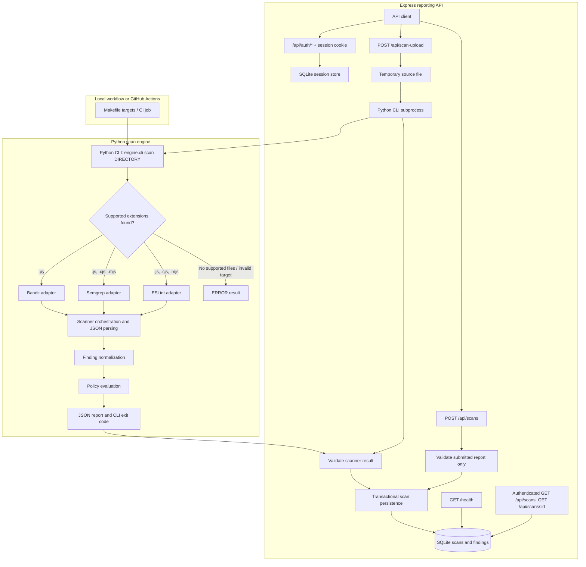
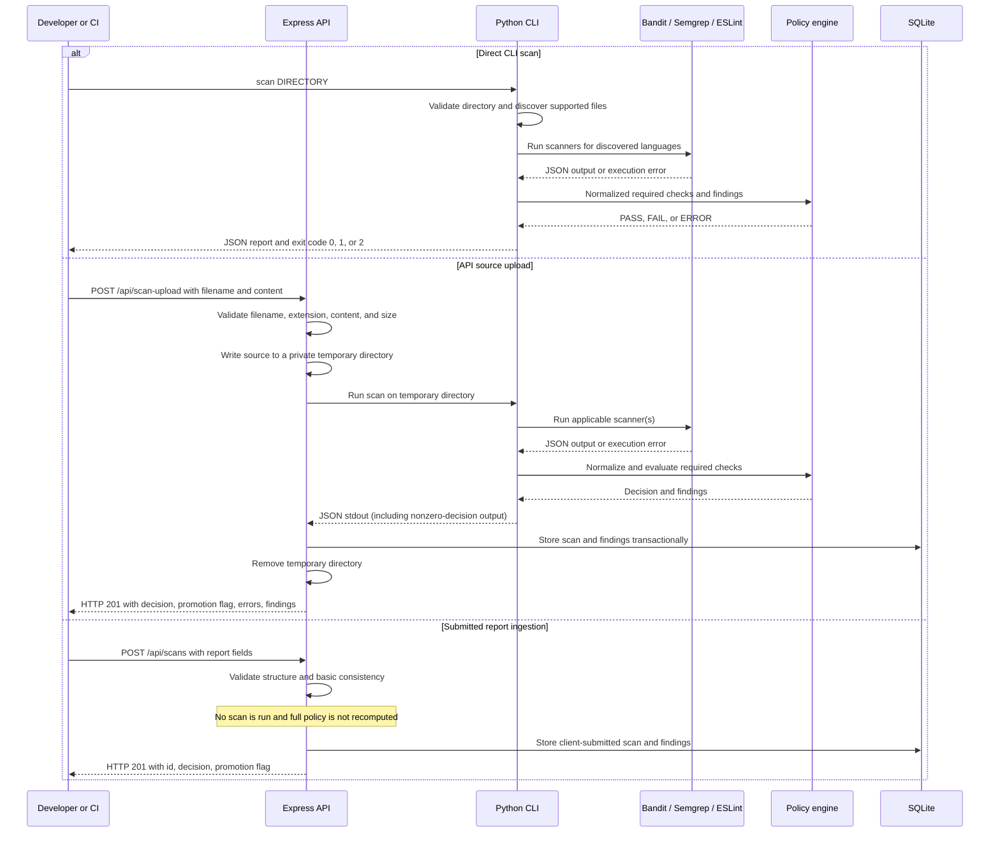
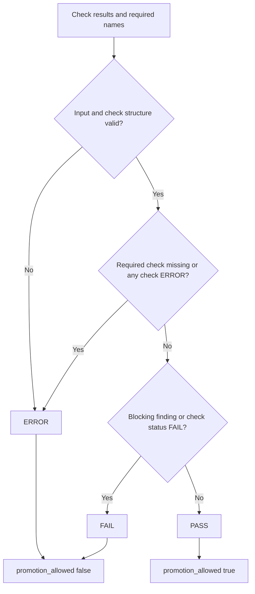

# SecureFlow Architecture

## Purpose and scope

SecureFlow is a fail-closed security gate for CI/CD pipelines. It identifies supported source files, runs the configured scanners, normalizes their findings, and evaluates the checks with a Python policy engine. The CLI emits a JSON decision and a process exit code so automation can distinguish a security failure from a scan or evaluation error.

The repository also contains an Express API and SQLite persistence. Registration, login, logout, current-user state, and per-user scan history use server-managed SQLite-backed sessions. The API can scan one uploaded source file by invoking the CLI, or accept a client-submitted report without scanning it. Submitted reports are marked unverified and are not independent gate evidence.

Implemented scanner coverage consists of Bandit for Python and Semgrep plus ESLint for JavaScript. The CLI discovers `.py`, `.js`, `.cjs`, and `.mjs` files; TypeScript files are not included by its target discovery. These integrations and the current local rules are not comprehensive security analysis. Deployment infrastructure and multi-file upload scanning are not implemented.

## System overview

The CLI and API are separate entry points. Both ultimately use the Python engine for an API source upload, but only the CLI returns its decision through process exit status. API report ingestion does not run scanners.



The diagram's API upload subprocess uses the same CLI scanner and policy path, then persists the resulting decision and findings. The submitted-report route follows a different path: it validates request fields and basic decision consistency, then stores the supplied data. It does not connect to the scanner engine.

## Component responsibilities

| Component | Responsibility and boundary |
|---|---|
| CLI | [`engine/cli.py`](../engine/cli.py) parses `scan DIRECTORY`, discovers supported files recursively, selects scanners based on file extensions, evaluates the checks, writes JSON to standard output, and maps the decision to exit code `0`, `1`, or `2`. |
| Scanner adapters | [`engine/scanners.py`](../engine/scanners.py) invokes Bandit, Semgrep, and ESLint with configured arguments, parses their JSON output, and converts scanner-specific fields into normalized findings. |
| Scanner process runner | [`engine/orchestrator.py`](../engine/orchestrator.py) runs configured argument lists without a shell, bounds execution and output, and represents failed execution as a check error. |
| Finding normalizer | [`engine/normalizer.py`](../engine/normalizer.py) validates common finding fields, maps severity values to the supported set, marks `CRITICAL` and `HIGH` as blocking by default, redacts selected secret-like patterns, restricts unsafe paths, and creates stable finding IDs. |
| Policy evaluator | [`engine/policy.py`](../engine/policy.py) validates check structures and required check names, aggregates blocking findings, chooses `PASS`, `FAIL`, or `ERROR`, and sets `promotion_allowed` only for `PASS`. |
| Express application | [`api/src/app.js`](../api/src/app.js) serves public/account pages, the protected console, health and scan routes, validates reports, and implements single-source uploads. Private routes use server-resolved session identity. |
| API server | [`api/src/server.js`](../api/src/server.js) binds to loopback by default, reads `SECUREFLOW_HOST` and `PORT`, and closes the server and database on termination signals. |
| SQLite adapter | [`api/src/db.js`](../api/src/db.js) initializes SQLite and applies a transactional `user_version` migration that preserves historical scans as unowned and unverified. [`api/src/sqlite-session-store.js`](../api/src/sqlite-session-store.js) persists opaque express-session records. |
| Scanner rules and ESLint config | [`rules/javascript-security.yml`](../rules/javascript-security.yml) defines the local Semgrep rules; [`api/eslint.config.mjs`](../api/eslint.config.mjs) provides ESLint's explicit flat configuration. |
| CI and tests | [`Makefile`](../Makefile), [`.github/workflows/ci.yml`](../.github/workflows/ci.yml), [`tests/`](../tests/), and [`api/tests/api.test.js`](../api/tests/api.test.js) define local checks, hosted workflow steps, and regression coverage. |

## Scan lifecycle

SecureFlow has three entry paths. Steps involving scanner discovery and policy evaluation apply to direct CLI scans and API source uploads, not to report ingestion.



### Direct CLI scanning

The CLI accepts exactly one subcommand, `scan`, with a directory argument. [`engine/cli.py`](../engine/cli.py) resolves the target and rejects a missing/non-directory target with `ERROR`. It recursively searches for Python extensions (`.py`) and JavaScript extensions (`.js`, `.cjs`, `.mjs`), case-insensitively. If neither set is present, it returns `ERROR` without running a scanner. If both languages are present, it runs all applicable checks and marks each one required.

For a valid scan, the CLI prints the report as indented JSON. It returns exit code `0` for `PASS`, `1` for `FAIL`, and `2` for any other decision (`ERROR`). A direct CLI scan does not persist results to SQLite or send them to the API.

### API source upload

`POST /api/scan-upload` accepts one source file in JSON. After input checks, the route writes it into a newly created system temporary directory, invokes `python -m engine.cli scan <temp-directory>` from the repository root, validates the resulting decision and checks, flattens check findings, and stores an upload scan record. It removes the temporary directory in a `finally` block. The route returns HTTP `201` for a processed `PASS`, `FAIL`, or `ERROR`; callers must inspect `decision` and `promotion_allowed`, not infer success from the HTTP status.

The API subprocess uses `execFile` (no shell command string), a 65-second timeout, and a 2,100,000-byte maximum output buffer. It parses JSON from stdout, including stdout attached to a nonzero-exit subprocess error. If output cannot be parsed or the returned result has invalid decision/promotion/check fields, the route substitutes an `ERROR` result. The route also validates the flattened findings before persistence. Failures during request processing or persistence return a server error; the temporary directory is still cleaned up when it was created.

## Scanner integration

The shared process runner in [`engine/orchestrator.py`](../engine/orchestrator.py) calls `subprocess.Popen` with argument arrays, `shell=False`, stdin closed, stdout/stderr captured, and a new POSIX process session. The default per-check timeout is 60 seconds. It retains at most 1,000,000 bytes from each output stream; timeouts, output overflow, launch errors, or output streams that do not close become `ERROR`. It kills the scanner process group on POSIX during cleanup. Scanner adapters override the accepted exit codes where a scanner uses a nonzero code to indicate findings.

### Bandit for Python

[`engine/scanners.py`](../engine/scanners.py) invokes:

```text
bandit -q -f json -r TARGET
```

Exit codes `0` and `1` are accepted as scanner output. Bandit code `1` is not by itself considered an execution failure: the adapter parses the JSON report and lets normalized blocking findings determine the policy result. A malformed report, missing `results` list, invalid `errors` list, non-empty Bandit `errors`, or scanner execution failure produces a check with status `ERROR`. Bandit's `test_id`, `issue_severity`, `issue_text`, filename, and line number are mapped into normalized finding fields. File paths are made relative to the target when they resolve beneath it.

### Semgrep for JavaScript

For a directory containing JavaScript extensions, the adapter runs Semgrep from the repository root with the local [`rules/javascript-security.yml`](../rules/javascript-security.yml) configuration, JSON output, `--no-git-ignore`, and the target directory. Exit codes `0` and `1` are parsed as report output. Semgrep findings use `check_id`, `extra.message`, `start.line`, and path. `extra.severity` maps as follows: `ERROR` to `HIGH`, `WARNING` to `MEDIUM`, and `INFO` to `LOW`. A missing or invalid results/errors structure, non-empty scanner `errors`, invalid finding metadata, unknown severity, invalid JSON, or process execution error makes the check `ERROR`.

The current local rules are `secureflow.javascript.eval`, which matches `eval($EXPR)`, and `secureflow.javascript.child-process-shell`, which matches `exec` or `execSync` calls as expressed in the rule. The latter rule's message describes dynamically constructed shell commands, but its shown pattern matches the call forms rather than proving the argument is dynamic. The source should be treated as the exact scope of these rules; they are not a broad JavaScript security ruleset.

### ESLint for JavaScript

The ESLint adapter runs the local binary at `api/node_modules/.bin/eslint` with [`api/eslint.config.mjs`](../api/eslint.config.mjs), JSON formatting, and no config lookup. For a general target directory it passes discovered `.js`, `.cjs`, and `.mjs` files explicitly. When the target is the repository's `api` directory, it scans `api/src` and `api/tests`. Exit codes `0` and `1` are accepted for JSON parsing; findings are then handled by policy. ESLint severity `2` maps to `HIGH`, severity `1` maps to `LOW`. A fatal parse/configuration error, invalid report structure, invalid severity value, malformed JSON, or process error results in check status `ERROR`.

### Finding normalization

All adapters call [`engine/normalizer.py`](../engine/normalizer.py). A normalized finding carries an ID, scanner, rule ID, severity, title, file, line, message, and blocking flag. The normalizer accepts the severities `CRITICAL`, `HIGH`, `MEDIUM`, `LOW`, and `INFO`; unknown severities become `INFO`. `CRITICAL` and `HIGH` are blocking by default, and an explicit `blocking: true` cannot be lowered by scanner output. Selected password/token-like strings, GitHub token forms, and AWS access-key identifiers are redacted in string fields. Unsafe or absolute file paths are omitted as `null`.

The scanner adapter can return check status `PASS` when it successfully parsed a report that contains findings. `PASS` at the check level means the scanner completed and produced a valid report; the policy's overall decision can still be `FAIL` because findings are blocking.

## Policy evaluation and fail-closed behavior

[`engine/policy.py`](../engine/policy.py) evaluates check records. The CLI passes a required-check list derived from the languages found: `bandit` for Python and `semgrep` plus `eslint` for JavaScript. The policy validates the check list, each check's unique non-empty name, status (`PASS`, `FAIL`, or `ERROR`), and findings list. Each finding must be an object; its `blocking` value defaults to `true` when missing and must otherwise be a boolean. A finding's reported `check` value cannot spoof the trusted check name, which is assigned by the evaluator.

| Decision | Conditions | `promotion_allowed` |
|---|---|---|
| `PASS` | Input is valid; all required checks are present; no check has status `FAIL`; no finding is blocking. | `true` |
| `FAIL` | No evaluation errors exist, and at least one check has status `FAIL` or a finding is blocking. | `false` |
| `ERROR` | Invalid input, malformed check/finding data, duplicate or missing required check, or any check has status `ERROR`. Evaluation errors take precedence over findings and check failures. | `false` |

In the normal scanner adapters, process/parse failures are represented as check status `ERROR`, which the policy converts into an overall `ERROR`. A valid report with blocking findings normally has check status `PASS` and overall decision `FAIL`. Missing target or unsupported/empty target are handled directly by the CLI as `ERROR` before policy evaluation.



`promotion_allowed` is a convenience field derived from the decision; it is not a separate override. Only overall `PASS` maps to CLI exit code `0`. `FAIL` maps to `1`, and `ERROR` maps to `2`. CI and deployment consumers must preserve and enforce these exit codes.

## API architecture and data flow

The API is implemented in [`api/src/app.js`](../api/src/app.js), started by [`api/src/server.js`](../api/src/server.js), and persists through [`api/src/db.js`](../api/src/db.js). It disables Express's `x-powered-by` header, parses strict JSON with a 256 KiB request-body limit, serves the public home and account forms, and protects the scan console and private APIs.

Startup requires `SECUREFLOW_SESSION_SECRET` (at least 32 bytes) and explicit `SECUREFLOW_COOKIE_SECURE=true|false`. Production additionally requires `NODE_ENV=production`, Secure cookies, and `SECUREFLOW_PUBLIC_ORIGIN` using HTTPS. `SECUREFLOW_TRUST_PROXY_HOPS` defaults to zero and accepts only `0` through `5`; set it only for a known TLS proxy topology. Sessions use `express-session` and a persistent SQLite store, with 30-minute idle expiry and a 12-hour absolute authentication lifetime. Mutations require JSON and a synchronizer token; an Origin header, when supplied, must match the configured origin or request origin.

The routes are:

| Method and route | Behavior and response |
|---|---|
| `GET /health` | Executes `SELECT 1`; returns `200 {"status":"ok"}` when the database is available or `503 {"status":"unavailable"}` otherwise. |
| `GET /api/auth/me` | Returns safe authenticated state and a synchronizer CSRF token; does not reveal the session ID or stored session. |
| `POST /api/auth/register`, `POST /api/auth/login` | Accept JSON with CSRF and origin checks; create accounts or authenticate with Argon2id and rotate the session ID. |
| `POST /api/auth/logout` | Requires authentication and CSRF; destroys the server-side session and expires the cookie. |
| `POST /api/scans` | Requires authentication and CSRF. Persists a client-submitted report as `verified = 0`; does not invoke scanners. |
| `POST /api/scan-upload` | Requires a valid CSRF token. Runs the scanner engine; authenticated uploads are owned by the current user, anonymous compatibility uploads remain unowned. |
| `GET /api/scans` | Requires authentication and filters only the caller's records. Supports bounded `page` (1 to 1,000,000), `limit` (1 to 50), target substring `q` (max 100 characters), `decision`, `verified`, and `scanner` filters; returns page metadata and account-wide aggregate metrics. |
| `GET /api/scans/:id` | Requires authentication and returns a scan with findings only when owned by the caller. Foreign and unknown IDs return `404`. |

Malformed JSON returns `400`; JSON exceeding the body-parser limit returns `413`. Other uncaught errors pass through the final error handler and return a generic `500` response. Individual handlers return validation errors as `400`, database persistence failures as `500`, upload processing failures as `500`, and upload admission rejection as `503` with `Retry-After: 1`.

### Submitted-report ingestion

`POST /api/scans` requires authentication, JSON, a matching synchronizer token, and an allowed `Origin` when present. It requires an object with a non-empty `target` of at most 1,000 characters, a decision from `PASS`, `FAIL`, or `ERROR`, a boolean `promotion_allowed`, and a `findings` array of at most 1,000 objects. The promotion flag must be true exactly when the decision is `PASS`; a `PASS` with any finding explicitly marked blocking is rejected. The authenticated user ID is taken from the server-side session; request `user_id` is ignored. Every such row is marked unverified regardless of submitted decision.

Each finding must include non-empty `scanner` and `rule_id` strings of at most 100 characters, a supported severity (`CRITICAL`, `HIGH`, `MEDIUM`, `LOW`, or `INFO`), a non-empty title of at most 500 characters, a non-empty message of at most 2,000 characters, and a boolean `blocking`. `file` may be absent or `null`, or a string of at most 500 characters; absolute paths, Windows drive-prefixed paths, `..` segments, and NUL characters are rejected. `line` may be absent or `null`, otherwise it must be a positive safe integer. The handler performs structural and limited consistency checks; it does not verify provenance, rerun scanners, or recompute the full policy from trusted scan evidence. Dashboard views label submitted records unverified and exclude their outcomes from verified decision counts.

### Source-upload scanning

`POST /api/scan-upload` requires a valid CSRF token, a filename string (non-empty after trimming and at most 255 characters), a non-empty string `content`, and a supported extension after lowercasing: `.py`, `.js`, `.cjs`, or `.mjs`. The source limit is 100 KiB measured as UTF-8 bytes. This source limit is separate from the 256 KiB JSON parser limit. Unsupported names/extensions or missing content return `400`; source over the limit returns `413`.

Before creating a temporary file or starting a scanner, the handler acquires a process-local FIFO scan slot. `SECUREFLOW_SCAN_CONCURRENCY` sets the active limit (default `2`) and `SECUREFLOW_SCAN_QUEUE_LIMIT` sets the waiting limit (default `4`; `0` disables waiting). When both are full, the route returns `503` with `Retry-After: 1`. Each admitted request holds its slot through temporary-directory cleanup; validation, scanner, persistence, and error exits release it in `finally`. A queued request is removed if its client disconnects, and an active scanner subprocess is aborted on disconnect. The limits are per Node.js process, not shared by workers or replicas.

After admission, the handler reduces the submitted filename to its basename, creates a `secureflow-upload-` directory under the operating system's temporary directory, and creates the file exclusively with mode `0600`. It runs `python -m engine.cli scan <temp-directory>` with `cwd` set to the project root, using `SECUREFLOW_PYTHON` or defaulting to `python`. The subprocess timeout is 65 seconds and its `maxBuffer` is 2,100,000 bytes. Scanner stdout is parsed as JSON; if the subprocess exits nonzero, stdout attached to the error is still parsed because valid `FAIL` and `ERROR` CLI decisions are nonzero exits. Invalid or inconsistent CLI results are replaced with an `ERROR` result. The route flattens `findings` from the returned checks, validates the resulting record, inserts it, and removes the temporary directory in `finally`.

The upload route's `201` means the source was processed and the result stored. It does not mean the scan passed. A caller must inspect the decision and promotion flag. Because the upload is a single file in a temporary directory, it cannot supply a complete multi-file project context.

## Data and persistence

[`api/src/db.js`](../api/src/db.js) creates or migrates these tables:

| Table | Columns | Role |
|---|---|---|
| `scans` | `id`, `target`, `decision`, `promotion_allowed`, `created_at`, `user_id`, `verified` | Stores one scan header. `user_id` is nullable with `ON DELETE SET NULL`; `verified` distinguishes scanner-produced output from submitted reports. |
| `findings` | `id`, `scan_id`, `scanner`, `rule_id`, `severity`, `title`, `file`, `line`, `message`, `blocking` | Stores findings attached to a scan. `severity` and `blocking` have permitted-value constraints; `scan_id` references `scans(id)` with cascade delete. `file` and `line` may be null. |
| `users` | `id`, `email_normalized`, `password_hash`, `created_at` | Stores normalized unique email and Argon2id encoded password hash. |
| `sessions` | `sid`, `sess`, `expired` | Stores express-session payloads and expiry in SQLite; IDs are opaque and never returned through API JSON. |
| `auth_rate_limits` | `bucket_key`, `window_started`, `attempts` | Stores HMAC-digested rate-limit keys and counters. |

Scan headers and their findings are inserted together using a `better-sqlite3` transaction. Schema version 1 is applied transactionally and additively; historical rows keep `user_id = NULL` and the `verified` default of `0`. No account is assigned existing data. The database enables SQLite foreign keys, write-ahead logging, and a 5,000 ms busy timeout. There is no implemented retention policy.

The default database file is `api/secureflow.db`; `SECUREFLOW_DB_PATH` can configure a different path. `GET /api/scans` returns a bounded, filtered page of headers owned by the signed-in user plus account-wide totals; verified outcome counts exclude unverified records. `GET /api/scans/:id` returns the header and findings only when owned by that user. Values stored by `POST /api/scans` originate with its caller and remain unverified.

The static authenticated dashboard uses `GET /api/auth/me` to establish the current user and CSRF token, then calls `GET /api/scans` for paginated activity and owner-scoped metrics. Selecting a row calls `GET /api/scans/:id`; filters for severity/scanner within that finding list run locally after the authorized detail response. Uploads use `POST /api/scan-upload` with the session cookie and CSRF token. `POST /api/auth/logout` invalidates the session. The UI labels `/api/scans` submissions unverified and does not treat their submitted decision as a promotion result; scanner-produced upload records are identified by `verified: true`.

## CI/CD integration

### Local Makefile

The root [`Makefile`](../Makefile) defines:

| Target | Command or behavior |
|---|---|
| `test-python` | `python -m pytest -v` |
| `test-api` | Runs `npm test` from `api/`. |
| `test` | Runs `test-python` and `test-api`. |
| `gate-test` | Runs `python scripts/verify_gate.py`. |
| `scan-engine` | Runs `python -m engine.cli scan engine`; its exit status is propagated. |
| `ci` | Runs `test`, `gate-test`, then `scan-engine`. |

[`scripts/verify_gate.py`](../scripts/verify_gate.py) scans `fixtures/bandit`, verifies the CLI exit is `1`, checks `decision == "FAIL"`, ensures promotion is false, and requires at least one blocking finding. The local test suite also exercises policy edge cases, scanner normalizers, JavaScript fixture behavior, API validation, and Python/JavaScript uploads.

### GitHub Actions

The workflow [`.github/workflows/ci.yml`](../.github/workflows/ci.yml) runs on pushes and pull requests targeting `main` or `master`. It runs on `ubuntu-latest`, has a 10-minute job timeout, and grants `contents: read`. It configures Python `3.14` and Node.js `22`, installs dependencies, runs `make test`, performs an inline vulnerable-fixture assertion, and scans the `engine` directory. Concurrency cancels superseded runs for the workflow/ref group.

The workflow configuration describes what GitHub Actions is set up to run; it is not evidence of a successful hosted run. Local test or gate success does not establish hosted CI health. Check actual Actions run results independently.

## Security boundaries and limitations

- **Source to scanner:** scanner tools execute as subprocesses over repository or uploaded source. Commands use argument arrays and no shell, with per-check timeout and output caps. These limits do not amount to sandboxing or full isolation from malicious scanner input.
- **Upload to temporary filesystem:** uploaded files are limited to 100 KiB, basename-sanitized, created with exclusive mode `0600`, and removed in a `finally` block. Admission limits active scans to two and queued requests to four per process by default; cleanup is best-effort, and these limits do not coordinate across processes or replace operating-system isolation and filesystem monitoring.
- **Scanner output to policy:** scanner JSON is parsed and structurally checked. Execution errors, timeouts, output overflow, malformed output, and scanner-reported errors fail closed rather than being interpreted as a clean scan.
- **Client to API:** account and private history routes resolve users from a signed opaque cookie and persistent server-side session. Mutations require synchronizer tokens and check Origin when supplied. The server defaults to `127.0.0.1`; `SECUREFLOW_HOST` can override the bind host.
- **Submitted report trust:** `/api/scans` accepts client-supplied decisions but marks each row `verified = 0`. Dashboard views do not present these claims as verified engine outcomes. They remain unsuitable as deployment authorization or trusted audit evidence.
- **Decision to deployment:** SecureFlow can only deny promotion when downstream automation honors its nonzero exit codes and decision. The current API persists results but is not wired into CI enforcement.
- **Coverage:** a `PASS` only means the configured scanner checks completed and policy found no blocking findings. The scanner set and rules can miss vulnerabilities; they do not provide complete SAST, dependency, container, or secret scanning coverage.

The API and scanner pipeline are under active development. The repository does not substantiate a production-readiness claim. See the [threat model](threat-model.md) for risk analysis and the [decision records](decisions.md) for accepted design choices and known incomplete work.

## Future improvements

The following are recommendations, not implemented functionality:

- Establish report provenance and independently verify submitted decisions before treating records as authoritative.
- Coordinate upload limits across API processes if deployment topology requires a shared quota, and isolate scanner execution in least-privilege workers with CPU/memory and network controls.
- Define production secret rotation, SQLite backup/retention, and recovery operations.
- Assess stronger isolation and least-privilege execution for scanners handling untrusted uploads.
- Add regression coverage for temporary-file cleanup failures, API subprocess timeouts/output limits, malformed scanner results, and safe-scan behavior in hosted CI.
- Define database retention, backup, and access-control procedures for deployments that rely on scan history.
- Expand scanner coverage only with explicit rules, normalized result semantics, failure behavior, and tests.

## Related documentation

- [Project README](../README.md)
- [Threat model](threat-model.md)
- [Demo guide](demo.md)
- [Architecture decision records](decisions.md)
