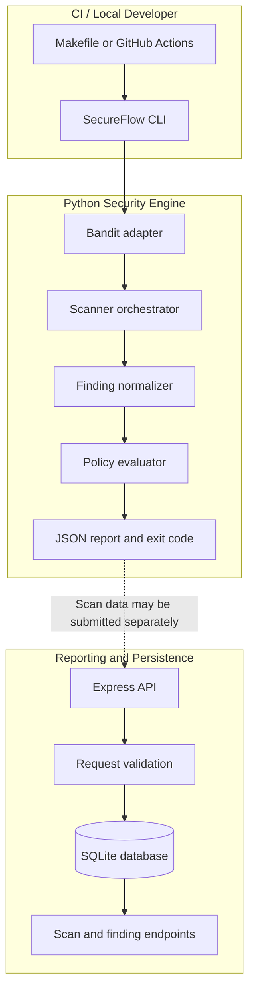

# SecureFlow Architecture

## 1. Purpose

SecureFlow is a CI/CD security gate that runs a configured scanner, normalizes its findings, evaluates policy, and emits a machine-readable decision.

The current implementation has two distinct paths:

1. **Security decision path:** the CLI invokes Bandit and evaluates its result using the policy engine.
2. **Reporting path:** the Express API accepts scan records, validates their structure and basic consistency, stores them in SQLite, and serves stored records.

The reporting API is not currently the authoritative policy evaluator used by CI.

## 2. System architecture



The dotted connection is conceptual: the current CI workflow does not automatically submit the CLI report to the API.

## 3. Security decision path

### 3.1 CI invocation

The CI workflow installs Python and Node.js dependencies, runs the test suites, verifies that the vulnerable fixture is blocked, and scans the engine directory.

The local equivalent is:

```bash
make ci
```

The command runs the targets defined in the Makefile. Hosted workflow status must be checked independently; a local pass does not establish that GitHub Actions completed successfully.

### 3.2 CLI

`engine/cli.py` accepts a target directory through the `scan` subcommand.

The CLI:

1. Resolves and validates the target directory.
2. Invokes the configured Bandit adapter.
3. Evaluates the resulting check using the required check name `bandit`.
4. Emits a JSON report.
5. Returns an exit code matching the decision.

A missing or invalid target produces `ERROR` and denies promotion.

### 3.3 Scanner orchestration

`engine/orchestrator.py` manages external check execution. The implementation uses argument lists rather than shell command strings, sets execution timeouts, and limits captured output.

`engine/scanners.py` invokes Bandit in recursive JSON-report mode. Bandit exit code `1` can indicate that findings were reported, so it is accepted as a scanner execution outcome rather than automatically treated as a scanner failure.

Execution failures, malformed JSON, and reported scan errors produce a check result with status `ERROR`.

### 3.4 Finding normalization

The scanner adapter converts Bandit output into SecureFlow's normalized finding representation.

Normalized findings include information such as:

- Scanner and rule identifier
- Severity
- Title and message
- Relative file path, when safely available
- Line number, when available
- Whether the finding blocks promotion

Normalization also applies severity handling, redacts supported secret patterns, and restricts unsafe file paths according to the normalizer implementation.

### 3.5 Policy evaluation

`engine/policy.py` evaluates the completed check results.

| Decision | Meaning | CLI exit code |
|---|---|---:|
| `PASS` | Required checks completed successfully and no blocking findings were detected | `0` |
| `FAIL` | A check failed or blocking findings were detected | `1` |
| `ERROR` | Invalid input, a missing required check, or an evaluation/check error prevents a reliable decision | `2` |

Only `PASS` sets `promotion_allowed` to `true`.

This is a policy decision based on the configured checks and findings; it is not proof that the scanned code contains no vulnerabilities.

## 4. Reporting and persistence path

### 4.1 Express API

The Express application is implemented in `api/src/app.js`.

The current endpoints include:

| Endpoint | Purpose |
|---|---|
| `GET /health` | Check API and database availability |
| `POST /api/scans` | Validate and persist a submitted scan and its findings |
| `GET /api/scans` | List recent scan records, with a bounded `limit` |
| `GET /api/scans/:id` | Retrieve a scan and its associated findings |

The application disables the `x-powered-by` header and limits JSON request bodies to 256 KiB. It also validates submitted field types, allowed decision and severity values, finding paths, and other input constraints.

The API checks that `promotion_allowed` agrees with the submitted decision and rejects a submitted `PASS` containing a finding marked as blocking. It does **not** independently rerun the scanner or recalculate the complete policy decision. Consequently, a structurally valid but fabricated decision could be stored.

Treat these records as submitted reporting data, not as independently authenticated evidence that promotion is safe.

### 4.2 SQLite

`api/src/db.js` initializes the SQLite database and creates the `scans` and `findings` tables.

The schema stores the decision and promotion flag with constraints on their permitted values. Findings reference their parent scan through a foreign key. The database also enables foreign-key enforcement, write-ahead logging, and a busy timeout.

The database path defaults to the API directory's `secureflow.db` file and can be overridden with `SECUREFLOW_DB_PATH`.

## 5. Trust boundaries

The main trust boundaries are:

1. **Repository code to scanner:** source files are analyzed by an external scanner process.
2. **Scanner output to policy engine:** scanner output must be parsed and validated before it can affect a decision.
3. **Client to reporting API:** incoming JSON is untrusted and requires validation.
4. **API to database:** submitted records are persisted subject to application validation and database constraints.
5. **CI decision to deployment:** downstream deployment configuration must honor SecureFlow's exit status and promotion decision.

The current reporting API does not authenticate clients. Its default server host is loopback, but configuration can override the bind address. It should not be exposed to an untrusted network without additional access controls.

## 6. Failure handling

SecureFlow distinguishes security findings from inability to evaluate a scan:

- Blocking findings result in `FAIL`.
- Missing required checks and invalid or incomplete evaluation result in `ERROR`.
- Scanner execution and parsing errors are not treated as clean results.
- Only `PASS` permits promotion.

This distinction is important for CI configuration: pipeline scripts must not ignore a nonzero exit code or continue deployment after an error.

## 7. Current scope and limitations

- Bandit is the configured scanner.
- The CLI is the current policy decision path used by CI.
- The API is a reporting and persistence layer, not an independent promotion authority.
- API authentication is not implemented.
- Scanner coverage is limited by the configured scanner and its detection capabilities.
- A passing scan does not guarantee the absence of vulnerabilities.

Future work can strengthen the trust boundary between scan evidence and stored decisions, introduce authenticated API access, and expand scanner coverage. Those should be documented as future capabilities until implemented and tested.
