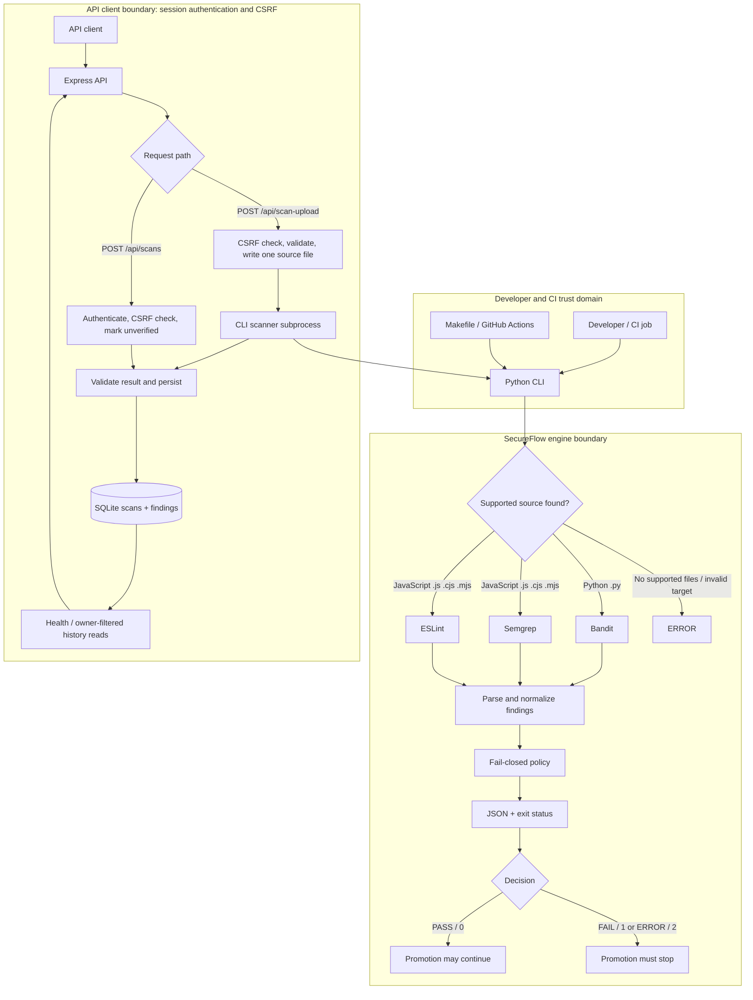
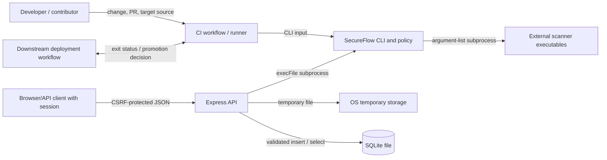

# SecureFlow Threat Model

## Purpose and scope

This threat model describes the security objectives, assets, trust boundaries, threat actors, verified controls, and residual risks for the SecureFlow implementation in this repository. SecureFlow is intended to act as a fail-closed CI/CD security gate: configured scanner checks produce findings that the Python policy engine converts into a decision and process exit status.

The implementation includes a Python CLI, Bandit for Python, Semgrep and ESLint for JavaScript, and an Express API backed by SQLite. The API can scan one uploaded source file through the CLI or accept an already-generated report. These are distinct paths: report ingestion validates and stores client-supplied values but does not scan source or recompute the complete policy decision. The GitHub Actions workflow tests the CLI and fixture behavior; it does not submit its result to the API.

This document distinguishes controls verified in source, configuration, and tests from recommendations. It is not a penetration-test report, formal verification, compliance attestation, or claim of production readiness. No successful hosted Actions run is asserted here.

## System overview

The CLI in [`engine/cli.py`](../engine/cli.py) recursively discovers `.py`, `.js`, `.cjs`, and `.mjs` files. It runs Bandit when Python is present, and both Semgrep and ESLint when JavaScript is present. [`engine/scanners.py`](../engine/scanners.py) adapts the scanners' JSON output; [`engine/normalizer.py`](../engine/normalizer.py) creates common findings; [`engine/policy.py`](../engine/policy.py) applies required-check and blocking rules. The CLI prints JSON and returns `0` for `PASS`, `1` for `FAIL`, and `2` for `ERROR`.

The Express application in [`api/src/app.js`](../api/src/app.js) exposes health, submitted-report, uploaded-source, and history routes. Uploads are written to a temporary directory and scanned by a CLI subprocess. Scan records and findings are inserted transactionally through [`api/src/db.js`](../api/src/db.js). The server in [`api/src/server.js`](../api/src/server.js) defaults to loopback but permits a configurable bind host.

The scanner and API subprocesses run within the host's privileges; the code configures time and output limits but does not create a sandbox. The diagram does not imply that API report ingestion invokes the scanners or that SQLite makes a submitted decision trustworthy.

## Security objectives and assets

| Asset | Security objective | Consequence if compromised |
|---|---|---|
| Gate decision and `promotion_allowed` | A decision must correspond to the required checks and their findings; only an overall `PASS` should permit promotion. | A false `PASS` can allow vulnerable code into a release; a false failure can block legitimate work. |
| Scanner results and normalized findings | Preserve scanner findings and represent severity, location, and blocking status consistently. | Lost or downgraded findings can produce false `PASS`; incorrect severity or paths can mislead triage. |
| Source targets and uploaded source | Keep proprietary source and embedded credentials confidential; do not let source compromise the scanning host. | Source disclosure, credential exposure, scanner exploitation, or resource exhaustion. |
| Scanner executables and Python/Node dependencies | Execute trusted, reviewed toolchain versions and configuration. | A compromised scanner or dependency can falsify findings, execute code, or compromise the runner/API host. |
| API scan history and access paths | Restrict reading and modification of reports to authorized parties. | Confidentiality loss, misleading audit records, or tampered scan history. |
| Temporary upload files | Create uploads safely, prevent collisions/path escape, and remove data after scanning. | Cross-request data exposure, overwrite/path abuse, or residual sensitive source on disk. |
| API and scanner process availability | Bound request and scan costs and avoid unbounded work. | Denial of service, stalled pipeline, or resource exhaustion on the host. |
| CI promotion decision | Make deployment depend on the gate's actual exit status and trusted result. | Ignored or bypassed failures permit promotion despite a blocking finding or incomplete scan. |
| SQLite database and backups | Preserve integrity and confidentiality of records and define access/retention practices. | Unauthorized disclosure or alteration; loss of history; unbounded accumulation of sensitive records. |

## Trust boundaries and assumptions

The diagram marks architectural boundaries, not proof of report provenance. The API authenticates users with SQLite-backed sessions, protects mutations with a synchronizer token and Origin checks, and filters private history by session-derived user ID. These controls do not make submitted report decisions trustworthy.

| Boundary | Trust stance and assumptions |
|---|---|
| Developer/contributor to CI | Changes and pull-request source are potentially untrusted until reviewed. The workflow runs tests and scans but does not prove all source safe. Workflow maintainers and repository branch protections are outside this repository's code evidence. |
| Source code to scanner | Treat repository and uploaded source as untrusted input. Scanner parsing is not a sandbox; scanners execute with the runner/API process's operating-system privileges. |
| CLI to scanner executable | Scanner commands are built from implementation-controlled argument lists and launched without a shell. The scanner binary, installed package, host, and runtime remain trusted dependencies. |
| API client to Express | Requests remain untrusted. Login and registration use Argon2id; private history and report submission require a server-resolved session; mutations require CSRF validation; login and registration use SQLite-backed rate limits. |
| Report submission to database | Report fields are client-controlled. Structural and consistency validation reduces malformed data but does not establish provenance or truth. |
| Uploaded source to temporary storage | Filename is reduced to a basename, file creation is exclusive with mode `0600`, and cleanup is attempted in `finally`. The temporary directory is not a dedicated sandbox or encrypted store. |
| API process to scanner subprocess | API uses `execFile`, a fixed CLI argument structure, timeout, and buffer cap. The Python executable can be selected with `SECUREFLOW_PYTHON`; the subprocess still runs on the same host without configured CPU/memory isolation. |
| CI decision to deployment | A downstream consumer must honor CLI exit codes. This repository's workflow does not include deployment steps or demonstrate an enforced required status check. |
| API/database host to operators | SQLite file access follows host filesystem permissions and deployment configuration. No application-level encryption, backup, deletion, or retention policy is implemented. |

## Threat actors

- **Malicious contributor:** can submit vulnerable or crafted source through a pull request. This matters because CI runs scanners over source and may execute parser/tool code against it.
- **Unauthenticated API client:** can access public pages, health, account bootstrap, and CSRF-protected anonymous upload compatibility. It cannot read scan history or submit stored reports without a valid account session.
- **Misleading report submitter:** can send a structurally valid but fabricated `PASS` to `POST /api/scans`. This matters if a dashboard or downstream process treats stored records as independently verified evidence.
- **Resource-exhaustion attacker:** can make repeated upload requests or submit source designed to consume scanner resources. Auth attempts are throttled and request/source limits exist, but uploads have no global rate/concurrency cap or CPU/memory quotas.
- **Compromised dependency or scanner supplier:** can alter scan behavior or execute code in the CI/API host context. The repository uses package manifests and a lockfile, but that alone does not guarantee dependency integrity or absence of known vulnerabilities.
- **Operator or workflow maintainer error:** can ignore exit codes `1`/`2`, use an incorrect target, expose the API, or fail to configure branch protection. SecureFlow cannot enforce downstream deployment policy by itself.

## Threat analysis

Priority terms are qualitative: **Critical** indicates a direct path to unauthorized promotion or host compromise with severe impact; **High** indicates likely confidentiality/integrity impact or material denial of service when the relevant exposure exists; **Medium** indicates meaningful but constrained or deployment-dependent impact; **Low** indicates limited impact under stated assumptions. Priorities are not outputs of a formal risk assessment. Likelihood depends on deployment exposure and is stated separately where it materially changes the risk.

| ID | Threat and affected objective | Attack path | Existing mitigations verified | Residual risk | Recommended next action | Priority and rationale |
|---|---|---|---|---|---|---|
| T1 | Fabricated `PASS` report misrepresented as a verified scan; decision/report integrity | An authenticated client posts a consistent `PASS`, `promotion_allowed: true`, and no explicitly blocking finding to `POST /api/scans`. | [`api/src/app.js`](../api/src/app.js) validates shape and consistency, derives ownership from the session, stores `verified = 0`, and the dashboard labels such records unverified. Tests cover forged `PASS` storage and display contract. | The route still accepts caller assertions and does not scan source, validate provenance, or recompute full policy. A downstream consumer could ignore `verified`. | Require authenticated CI provenance or recompute policy from trusted scanner output before treating any report as authoritative. | **High** if a consumer ignores the marker; otherwise **Medium** for misleading audit history. |
| T2 | Findings lost, downgraded, or misattributed; decision integrity | Malformed or unexpected scanner output, severity conversion, path handling, or normalizer logic changes finding semantics. | [`engine/scanners.py`](../engine/scanners.py) validates report shapes and scanner errors; [`engine/normalizer.py`](../engine/normalizer.py) maps severities and defaults HIGH/CRITICAL to blocking; scanner tests verify Bandit, Semgrep, and ESLint mappings and paths. | Parsers and mappings can still have defects or miss scanner schema changes. Unknown generic severities become `INFO`; false negatives remain possible. Test coverage is finite. | Add version/schema compatibility tests and regression cases for malformed/edge scanner reports; review mapping changes as policy changes. | **High** because a dropped/downgraded finding can cause a false `PASS`; likelihood is medium and change-dependent. |
| T3 | Scanner failure interpreted as clean; decision integrity | Scanner absent, exits unexpectedly, times out, outputs invalid JSON, reports errors, or exceeds output cap. | [`engine/orchestrator.py`](../engine/orchestrator.py) returns `ERROR` for launch failure, timeout, output overflow, and invalid command cases; adapters reject invalid JSON/reported errors; [`engine/policy.py`](../engine/policy.py) makes check `ERROR` fail closed. Tests cover timeout, output limits, invalid JSON, and scanner errors. | Runtime failures beyond tested paths and downstream scripts that suppress exit codes remain risks. The API upload may return HTTP `201` for a scan `ERROR`, so consumers must inspect the body. | Retain fail-closed semantics, add API upload error-path tests, and require deployment consumers to check decision and exit code. | **High** because treating an error as clean enables promotion; implementation controls exist, but bypass likelihood depends on integration. |
| T4 | Missing required check or malformed policy input authorizes promotion; decision integrity | A check is omitted, duplicated, has an invalid status/findings shape, or supplies malformed `blocking`. | CLI constructs required names based on discovered languages. [`engine/policy.py`](../engine/policy.py) rejects missing required checks, duplicate names, invalid statuses, missing/non-list findings, invalid finding objects, and non-boolean blocking values. [`tests/test_policy.py`](../tests/test_policy.py) covers these cases. | The policy is only as complete as the CLI's discovery logic and required-check construction. A directory with no supported extensions is an error, but an unsupported language file is not scanned if some supported files are present. | Add tests for mixed targets and discovery edge cases; keep required scanner selection explicit and review changes. | **High** because a skipped applicable check could yield false confidence; currently constrained by tested logic. |
| T5 | Malicious upload source or filename compromises scanning or host; source confidentiality and host integrity | A caller with a CSRF bootstrap can upload crafted source to `POST /api/scan-upload`; source is written and scanned on the API host. | [`api/src/app.js`](../api/src/app.js) requires a CSRF token, non-empty filename/content, maximum filename length 255, allowed extensions `.py`, `.js`, `.cjs`, `.mjs`, basename handling, UTF-8 size cap, exclusive file creation, and CLI invocation with fixed arguments via `execFile`. Tests exercise safe/vulnerable Python/JavaScript uploads. | Validation and authentication do not make source safe. Scanners and parser dependencies execute on the same host without a sandbox, seccomp/container isolation, dedicated low-privilege identity, or network restrictions verified here. | Before untrusted exposure, scan in disposable least-privilege workers/containers with read-only toolchain, no secrets, restricted filesystem and egress, and cleanup of worker resources. | **High** given scanner-host code execution/resource impact; likelihood is exposure-dependent and elevated if API is reachable by untrusted clients. |
| T6 | Temporary-file collision, unsafe file handling, or failed cleanup; uploaded-source confidentiality | Repeated or crafted filenames target an existing path or cause data to remain in temporary storage. | API creates a unique `mkdtemp` directory, reduces names with `path.basename`, writes with `flag: "wx"` and mode `0600`, and attempts recursive removal in `finally`; tests cover extension and size validation. | Cleanup errors are swallowed; no test verifies cleanup failure behavior. Host temp storage permissions, encryption, disk quotas, and crash cleanup are not configured. | Add cleanup tests/monitoring; use an isolated per-job volume with quota and lifecycle cleanup, and avoid treating temp files as encrypted. | **Medium** because unique directory/exclusive creation reduce collision/path risks, but residue is possible after failures/crashes. |
| T7 | Scanner/API resource exhaustion; service availability | Attacker repeats uploads or supplies expensive source; scanner consumes CPU/memory/processes, or concurrent requests create load. | Upload source max is 100 KiB; JSON body parser max is 256 KiB; scanner subprocess has a 65-second timeout and 2,100,000-byte max buffer; scanner runner has 60-second default per-check timeout and 1,000,000-byte per-stream cap. Upload admission limits active scans and queued work per process and rejects excess with `503` and `Retry-After`. Login and registration use shared SQLite rate limits. | Upload admission is process-local, not per-client or shared across workers/replicas. A single source can still consume CPU/memory within the timeout; no CPU/memory quota or sandbox is implemented. | Restrict access, coordinate limits if multiple API processes are deployed, and enforce OS/container CPU, memory, process, disk, and wall-clock limits. | **High** for an exposed API due to service/host availability; likelihood depends on reachability and request volume. |
| T8 | Misconfigured public API exposure; confidentiality and integrity | Operator binds the API to a network interface or proxy and misconfigures production secrets, TLS, trusted proxy hops, or account protections. | Startup requires a 32-byte session secret and, in production, HTTPS origin and Secure cookies; login/register use Argon2id, CSRF, Origin checks, and SQLite-backed throttling. History and report submission require authenticated sessions. | Application auth cannot compensate for weak/compromised secrets, missing TLS, unsafe proxy trust, host access, or exposure of anonymous upload scanning. | Keep network and TLS controls in place; use secret management, exact proxy hops, and operational review before external exposure. | **High** if deployment configuration is unsafe; depends on topology and operation. |
| T9 | Unauthorized reading or alteration of scan history; report confidentiality/integrity | Attacker steals a valid session or exploits host/database access; user tries to access another user's scan ID. | Parameterized SQL, session-derived ownership filters, 404 for non-owned IDs, HttpOnly cookies, logout invalidation, absolute expiry, CSRF on writes, and isolation tests. | XSS, host compromise, database file access, or session-secret compromise can still expose or tamper with data. No audit log or database ACL management is implemented. | Protect host/database/backups, use TLS and CSP/XSS controls, and define audit and recovery procedures. | **High** for a compromised identity or host; otherwise reduced by route-level ownership checks. |
| T10 | Sensitive code/findings leak via logs, responses, or database; confidentiality | Upload source or report contains secrets; source is written temporarily, findings/errors returned, or client-provided messages persist. | Finding normalizer redacts selected secret-like patterns; upload files use mode `0600`; API upload errors are generic and no longer log exception objects. | Redaction is pattern-limited and does not run on client-submitted reports. Upload response includes findings and scanner errors; stored report messages and source-derived findings remain sensitive. No retention or encryption controls are implemented. | Minimize data returned, redact at appropriate trust boundaries, restrict API/database access, define retention and backups. | **High** for proprietary source/secrets if API or host access is broad; likelihood depends on deployment and report content. |
| T11 | Dependency or scanner compromise; gate integrity and host integrity | Malicious or vulnerable Python/npm package or scanner binary executes during CI/API scanning. | Dependencies are declared in [`requirements.txt`](../requirements.txt) and npm lockfile; workflow uses read-only `contents` permission and installs from lock/config files. | No dependency vulnerability assessment, signature verification, action pinning to immutable commit SHAs, or isolated scanner runtime is established by the inspected workflow. Lockfiles do not guarantee safe dependencies. | Add automated dependency/advisory review, verify tool provenance, pin actions according to policy, and limit CI/API secrets and permissions. | **High** because compromise can falsify decisions or execute in runner context; likelihood is supply-chain dependent. |
| T12 | CI ignores `FAIL`/`ERROR` and promotes anyway; promotion integrity | A workflow uses `continue-on-error`, discards exit status, gates the wrong step, or deployment bypasses the check. | CLI returns distinct `0`/`1`/`2`; workflow runs the scan as a normal step, so nonzero exit normally fails the job; vulnerable-fixture step asserts exit `1`, `FAIL`, denied promotion, and blocking finding. | Branch protection and deployment requirements are repository-host settings not verified here. The workflow has no deployment job and does not establish status-check enforcement. | Configure the relevant CI check as required; test workflow behavior for both exit `1` and `2`; ensure deployment depends on the successful scan job. | **Critical** if deployment can bypass the gate; likelihood cannot be assessed from repository files alone. |
| T13 | Static analysis misses Python/JavaScript vulnerabilities; coverage objective | Vulnerability is outside Bandit, local Semgrep rules, ESLint rules, supported extensions, or scanner visibility. | The engine selects only `.py`, `.js`, `.cjs`, and `.mjs`; local Semgrep rules and ESLint configuration are explicit. Fixtures test examples of blocking and safe cases. | Static analysis has false positives and false negatives. JavaScript rules are narrow; TypeScript files are not discovered. No comprehensive dependency, container, runtime, or secret scanner is configured in the inspected files. | Document coverage, tune rules with tests, add complementary analysis based on risk, and retain review/testing beyond this gate. | **High** for assurance expectations: a `PASS` is limited evidence, not absence of vulnerabilities. Likelihood is inherent to static analysis. |
| T14 | SQLite corruption, tampering, disclosure, or unbounded retention; history integrity/confidentiality/availability | Local user/process reads or edits the DB or backups; disk fills as records accumulate; concurrent use exceeds intended workload. | [`api/src/db.js`](../api/src/db.js) uses parameterized statements in app handlers, foreign keys, value constraints, WAL, 5-second busy timeout, and indexes; scan/finding inserts are transactional. | No application-managed file permissions, encryption, backup, restore, retention, deletion, or disk quota is configured. No production deployment topology or workload is specified. | Set host ACLs, protect and test backups, define retention/deletion and capacity monitoring, and validate SQLite suitability for the actual deployment. | **Medium** for a local single-instance use; **High** where records are sensitive or DB/backup access is broad. |

## Existing security controls

The following controls are present in the inspected code or configuration. Their scope is limited; none alone establishes system security.

| Control verified | Evidence | What it mitigates | What it does not mitigate |
|---|---|---|---|
| Fail-closed policy and derived promotion flag | [`engine/policy.py`](../engine/policy.py); [`tests/test_policy.py`](../tests/test_policy.py) | Missing required checks, invalid inputs, check errors, blocking findings, and failed checks do not permit promotion. | Does not prove scanners found every issue or prevent downstream automation from ignoring status. |
| Language-derived required checks | [`engine/cli.py`](../engine/cli.py) | Requires Bandit for discovered Python and Semgrep plus ESLint for discovered JavaScript. Empty/unsupported targets return `ERROR`. | Does not scan unsupported extensions such as TypeScript, nor prove the selected scanner covers all relevant code. |
| Scanner result parsing and errors | [`engine/scanners.py`](../engine/scanners.py), [`engine/orchestrator.py`](../engine/orchestrator.py), [`tests/test_scanners.py`](../tests/test_scanners.py), [`tests/test_orchestrator.py`](../tests/test_orchestrator.py) | Invalid JSON, scanner-reported errors, process failures, timeout, and output overflow become check errors. | Does not eliminate parser defects, tool bugs, or adversarial scanner-input vulnerabilities. |
| Subprocess invocation and limits | [`engine/orchestrator.py`](../engine/orchestrator.py) | Uses argument lists, `shell=False`, closed stdin, timeout, output caps, and process-group cleanup on POSIX. | Not a sandbox; no CPU/memory quota, privilege drop, filesystem restriction, or network egress block is configured. |
| Finding normalization | [`engine/normalizer.py`](../engine/normalizer.py); scanner tests | Normalizes severity and fields, makes HIGH/CRITICAL blocking by default, rejects unsafe paths, and redacts selected secret patterns. | Redaction is incomplete and limited to recognized patterns; submitted API reports bypass this normalizer. |
| Upload validation and storage | [`api/src/app.js`](../api/src/app.js), [`api/src/scan-limiter.js`](../api/src/scan-limiter.js); API tests | Checks CSRF, filename length, basename, extension allowlist, non-empty content, 100 KiB UTF-8 limit; bounds active and waiting scans per process; uses unique temp dir, exclusive file creation and mode `0600`; removes temp dir in `finally`. | Does not make source safe, provide a sandbox, coordinate limits across processes, or guarantee cleanup after process/host crash. Cleanup errors are ignored. |
| API identity, body, and report validation | [`api/src/auth.js`](../api/src/auth.js), [`api/src/app.js`](../api/src/app.js); API tests | Argon2id credentials, SQLite-backed sessions, CSRF and Origin checks, auth rate limits, per-user history filters, strict JSON body cap, and report-shape validation. | Report ingestion does not rescan or fully recompute policy; anonymous upload scans remain available; there is no global upload quota. |
| Database parameterization and transactional writes | [`api/src/app.js`](../api/src/app.js), [`api/src/db.js`](../api/src/db.js) | Prepared statements prevent values from being concatenated into the shown SQL; transaction keeps scan/finding insertion together; schema constraints and FK support consistency. | Does not prevent a caller from submitting false but structurally valid data or protect the DB file from host-level access. |
| CI permissions, runtime pins, timeout, and tests | [`.github/workflows/ci.yml`](../.github/workflows/ci.yml), [`Makefile`](../Makefile), [`scripts/verify_gate.py`](../scripts/verify_gate.py) | Workflow has `contents: read`, 10-minute job timeout, Python 3.14 and Node 22; tests and vulnerable-fixture assertion are configured. | Does not prove hosted runs succeeded, establish branch protection, pin actions to immutable SHAs, or verify deployment enforcement. |

## Risk prioritization

The highest practical risks depend strongly on how the API is deployed:

1. **Treat deployment configuration and scanner isolation as operational gates.** Authenticated history and report routes now use session controls, but the API can still be re-bound from `127.0.0.1`, and anonymous CSRF-protected upload scans remain available for compatibility. Production needs TLS, correctly trusted proxies, protected secrets, and isolated scanner workers before untrusted exposure.
2. **Do not treat `POST /api/scans` records as verified gate evidence.** A consistent but fabricated `PASS` is accepted but marked unverified. Downstream consumers must honor that marker; it is a decision-integrity risk if any release or audit process ignores it.
3. **Isolate uploaded-source scanning before accepting untrusted uploads.** The implementation uses fixed subprocess arguments and time/resource bounds, but does not isolate scanner execution from the host or provide CPU/memory limits. A scanner or parser vulnerability could affect the API host.
4. **Verify downstream enforcement.** The CLI is fail-closed in its implementation, but the repository does not establish required branch protection or deployment dependencies. A consumer that ignores exit status can bypass the gate.
5. **Treat findings and stored reports as sensitive.** History is account-scoped, but there is no retention policy, host/database access control, or comprehensive redaction for caller-submitted reports.

These are qualitative priorities based on code paths and plausible impact. Likelihood cannot be determined without deployment network topology, host privileges, branch protection, data sensitivity, concurrency, and operator practices. No penetration test or hosted CI run is evidenced by this assessment.

## Security recommendations and remediation roadmap

The following actions remain recommendations; authentication and report labeling described above are implemented.

| Horizon | Recommended work | Risk addressed |
|---|---|---|
| Immediate, before untrusted network exposure | Keep API bound to loopback or use TLS, exact proxy trust, protected secrets, and network controls. Do not use submitted-report records as authoritative promotion evidence. | Deployment exposure, session compromise, and fabricated reports. |
| Immediate, before scanning untrusted uploads | Run scans in disposable, least-privilege workers with no production secrets, constrained filesystem access, CPU/memory/process quotas, and restricted outbound network access; coordinate admission limits if multiple API processes are deployed. | Scanner compromise, malicious input, and resource exhaustion. |
| Short term | Add a global upload rate/concurrency cap and account recovery controls; keep auth attempt throttles under deployment review. | Repeated expensive work and account lifecycle gaps. |
| Short term | Separate imported reports from verified scan results. Accept authoritative decisions only from authenticated CI evidence, or recompute policy from trusted normalized scanner output on the server. | False `PASS`, report provenance, inconsistent decision data. |
| Short term | Add regression tests for forged reports, missing/invalid scanner results, API subprocess timeout and output failures, temporary-file cleanup, concurrent upload pressure, secret leakage, and CLI exit `2`. | Fail-open regressions and uncovered API error paths. |
| Short term | Configure repository protection/deployment dependencies so exit `1` and `2` cannot be ignored; verify actual hosted Actions behavior and protect the scan job as a required status check where appropriate. | Gate bypass and CI configuration drift. |
| Longer term | Establish dependency advisory review and tool/action provenance policy; update dependencies deliberately and verify scanner versions. | Supply-chain compromise and vulnerable dependencies. |
| Longer term | Define SQLite file permissions, backups, restoration, retention/deletion, disk monitoring, and log handling for the intended deployment. | Data confidentiality, integrity, availability, and lifecycle. |
| Longer term | Expand scanner coverage based on risk, with explicit rule semantics, severity mappings, and regression tests; include unsupported languages only through intentional discovery/configuration changes. | False negatives and incomplete coverage. |

## Residual risk and limitations

Static analysis cannot guarantee the absence of vulnerabilities. Bandit, Semgrep's local rules, and ESLint can produce false positives and false negatives, and they only cover the file types, rules, and configurations actually invoked. The current CLI does not discover TypeScript extensions. The local Semgrep rules are narrow, and the presence of a configured scanner does not establish comprehensive SAST, dependency, container, or secret scanning.

The policy is fail-closed for represented check errors, missing required names, malformed inputs, and blocking findings. That guarantee does not cover untested defects in scanner adapters, an unsupported file that is not selected, an incorrectly configured consumer, or an operator bypass. API report ingestion is especially distinct: it authenticates the submitter and labels the record unverified, but does not rescan the source or establish report provenance.

Deployment-specific risks remain unknown because no production topology, network policy, host isolation, filesystem ACLs, database backup/retention policy, or branch-protection configuration is defined here. The repository's tests demonstrate selected behavior; they do not constitute a comprehensive security assessment or penetration test. A successful local test run is not evidence of hosted GitHub Actions success.

## Related implementation and documentation

The following repository files provide implementation evidence for this threat model and support further security review.

### Architecture and project documentation

- [Architecture](architecture.md) — components, system boundaries, and data flows.
- [Project README](../README.md) — project overview, setup, and usage.
- [Demo guide](demo.md) — instructions for demonstrating scan behavior.
- [Architecture decision records](decisions.md) — documented design decisions and trade-offs.

### Security enforcement and scanner implementation

- [CLI and scanner selection](../engine/cli.py) — scan entry point and orchestration.
- [Scanner adapters](../engine/scanners.py) — scanner execution and finding normalization.
- [Process orchestration](../engine/orchestrator.py) — subprocess execution and related safeguards.
- [Finding normalizer](../engine/normalizer.py) — finding normalization behavior.
- [Policy evaluator](../engine/policy.py) — policy validation, gate decisions, and fail-closed behavior.

### API and persistence

- [API routes and upload workflow](../api/src/app.js) — request validation, report submission, source uploads, and scan retrieval.
- [API server configuration](../api/src/server.js) — server startup and configuration.
- [SQLite schema and connection settings](../api/src/db.js) — database initialization and connection settings.

### Tests and CI

- [Python policy tests](../tests/test_policy.py)
- [Scanner and normalization tests](../tests/test_scanners.py)
- [Process orchestration tests](../tests/test_orchestrator.py)
- [CLI tests](../tests/test_cli.py)
- [API tests](../api/tests/api.test.js)
- [CI workflow](../.github/workflows/ci.yml)

These files provide evidence of selected implementation behavior and test coverage. Their existence does not, by itself, establish that every security property is satisfied or that SecureFlow has undergone a comprehensive security assessment.
