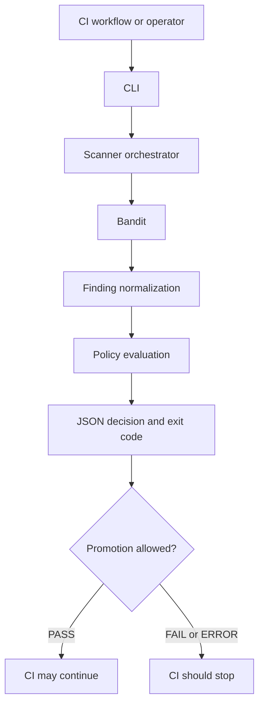
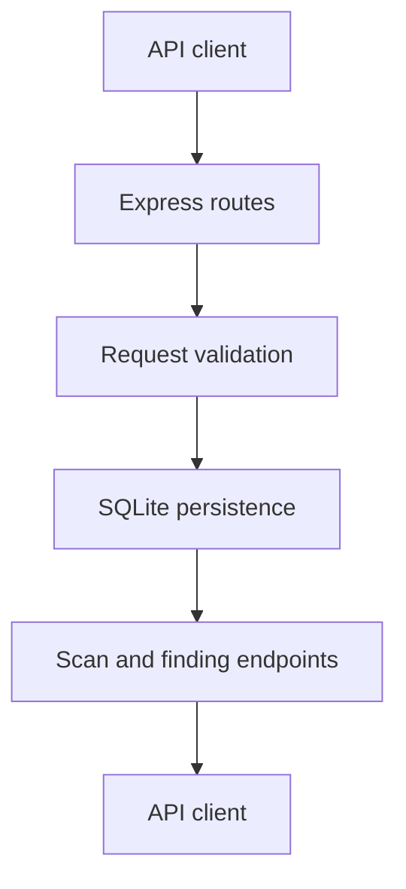

# SecureFlow Threat Model

## 1. Purpose and Scope

This document describes the security assumptions, trust boundaries, threats, and mitigations relevant to SecureFlow.

SecureFlow is a fail-closed security gate for CI/CD workflows. Its current scanner integration uses Bandit to identify potential security issues in Python code. The gate normalizes scanner findings, evaluates policy, and emits a machine-readable decision with an exit code.

The repository also includes an Express API and SQLite database for storing and retrieving scan reports.

This threat model reflects the inspected implementation. It does not imply that every recommended mitigation has already been implemented.

## 2. Security Objectives

SecureFlow aims to:

- **Fail closed:** missing required checks, invalid policy input, and scanner errors must not authorize promotion.
- **Preserve decision integrity:** a promotion must not be authorized when a required check fails or a blocking finding is present.
- **Limit execution risk:** scanner execution must use controlled arguments and bounded execution time and output.
- **Protect report integrity:** API requests must be validated before reports are stored.
- **Minimize information exposure:** findings and scanner output should not unnecessarily expose secrets or internal details.
- **Make decisions auditable:** structured results should explain the decision and provide findings for review.

## 3. Assets to Protect

| Asset | Security importance |
|---|---|
| Source code and scan targets | May contain proprietary code, credentials, or exploitable vulnerabilities |
| Scanner execution environment | Must not be compromised by untrusted target content |
| Normalized findings | Must accurately represent scanner results without leaking sensitive values |
| Policy decision | Determines whether a build may proceed |
| Scan reports and finding records | Must remain consistent and trustworthy |
| CI credentials and workflow permissions | Could enable repository or supply-chain compromise if misused |
| SQLite database | Stores scan history and finding details |
| API availability | Supports access to persisted scan reports |

## 4. System Boundaries and Trust Assumptions

### 4.1 Security decision path

The CLI invokes the scanner, normalizes its output, evaluates the required checks, and returns a JSON result with an exit code.

The CI workflow and any deployment process consuming the result are trusted to honor the exit code and decision. If a downstream workflow ignores the result or bypasses the gate, SecureFlow alone cannot prevent promotion.

### 4.2 Reporting API path

The API accepts submitted scan reports, validates their structure and some decision/finding consistency rules, and persists them in SQLite.

The reporting API is a separate path from the CLI policy decision. The inspected CI workflow does not automatically submit CLI results to the API. The API does not independently execute Bandit or fully recompute the policy decision from scanner evidence.

### 4.3 Trust assumptions

- CI runners, the Python and Node runtimes, and installed dependencies are part of the trusted execution environment.
- Repository code and dependency changes are reviewed before being trusted.
- Scan targets and scanner output must be treated as potentially hostile input.
- API callers may submit inaccurate or deliberately misleading report data.
- Database contents and stored reports are only as trustworthy as the validation and access controls protecting them.
- Any workflow consuming the gate must enforce its result rather than treating the report as informational.

## 5. Threats and Mitigations

| Threat | Potential impact | Existing controls | Remaining risk / recommended action |
|---|---|---|---|
| Scanner finds a high-risk issue but the build is promoted | Vulnerable code reaches deployment | Policy evaluation blocks configured blocking findings; CI fixture verifies a vulnerable scan is denied | Add and maintain explicit safe-pass and vulnerable-block CI assertions |
| Required scanner check is missing or fails | Incomplete assessment is mistaken for success | Policy is fail-closed for missing required checks and failed checks | Add regression tests for malformed and incomplete scanner results |
| Scanner process hangs | CI resource exhaustion or stalled pipeline | Execution timeout and process-group cleanup | Test timeout behavior in CI and keep limits configurable only through trusted configuration |
| Scanner emits excessive output | Memory or log exhaustion | Per-stream output limits | Add regression tests for output-limit handling and verify truncated output cannot be interpreted as a successful scan |
| Malicious target content affects scanner execution | Unintended command execution or resource consumption | Scanner command is passed as an argument list with `shell=False`; execution is bounded | Run scans with least privilege and isolate untrusted pull-request code in disposable runners |
| Scanner output contains secrets or sensitive paths | Credential or information disclosure | Finding normalization includes secret-pattern redaction and path checks | Add redaction tests for real-world secret formats; review logs and API responses for accidental disclosure |
| API client submits a fabricated PASS report | False audit record or misleading dashboard | Request validation checks decision/promotion consistency and rejects PASS reports containing explicitly blocking findings | API does not independently recompute the policy decision; add authentication, authorization, provenance verification, and server-side decision validation |
| Unauthorized party reads or modifies scan reports | Confidentiality or integrity loss | No API authentication was present in the inspected implementation; the server defaults to loopback binding | Treat the API as trusted-local only until authentication and authorization are implemented; do not expose it to untrusted networks |
| API receives malformed or oversized requests | Crashes, resource exhaustion, or invalid records | Express JSON body-size limit and request validation | Add rate limiting, request-size tests, and consistent error handling before wider deployment |
| Database file is accessed or modified outside the API | Scan history disclosure or tampering | SQLite constraints, foreign keys, WAL mode, and busy timeout support database behavior and consistency | Restrict filesystem permissions, protect backups, and define retention and recovery procedures |
| Dependency or workflow compromise | Malicious code runs in CI or gate behavior changes | Workflow uses read-only `contents` permission and a job timeout | Pin or otherwise control third-party actions and dependencies according to project policy; review lockfiles and workflow changes |
| CI gate is bypassed or its result ignored | Vulnerable code is promoted despite a failed scan | CLI uses distinct exit codes for PASS, FAIL, and ERROR | Make the gate a required status check and verify deployment cannot proceed around it |

## 6. Important Existing Controls

The inspected implementation includes these controls:

- **Fail-closed policy evaluation:** promotion is allowed only for a PASS decision.
- **Required-check validation:** missing required checks do not result in a successful decision.
- **Scanner execution boundaries:** scanner commands are invoked without a shell, with timeouts and output limits.
- **Structured results:** the CLI emits machine-readable JSON and uses distinct exit codes.
- **API input checks:** submitted report structures and certain decision/finding consistency conditions are validated.
- **Database constraints:** SQLite uses foreign keys and schema constraints.
- **CI permissions and time limits:** the workflow uses read-only repository contents permission and a job timeout.

These controls reduce risk but do not constitute a complete security certification or guarantee that all possible attacks are prevented.

## 7. Known Gaps

The following gaps should remain visible until addressed and verified:

1. **No API authentication or authorization was present in the inspected API code.** Loopback binding is a useful default but can be overridden through configuration.
2. **The API does not independently establish the truth of submitted scan decisions.** A fabricated PASS without an explicitly blocking finding may pass the existing consistency checks.
3. **Bandit is the current scanner integration.** The project should not be described as providing comprehensive SAST, dependency, container, or secret scanning unless those integrations are added.
4. **CI verification should cover both outcomes.** The vulnerable fixture verifies blocking behavior; a dedicated safe-target assertion would make successful behavior explicit.
5. **Hosted CI status must be verified independently.** A local test pass does not establish that the hosted GitHub Actions workflow starts and completes successfully.
6. **Operational controls remain necessary.** Runner isolation, dependency review, filesystem permissions, retention, and downstream enforcement are outside what the current gate alone can guarantee.

## 8. Recommended Priorities

### P0 — Before exposing the API beyond a trusted local environment

- Implement authentication and authorization appropriate to the deployment.
- Prevent untrusted clients from submitting reports that appear to be authoritative gate decisions.
- Recalculate policy server-side from trusted scanner evidence, or clearly separate untrusted imported reports from verified gate results.
- Ensure deployment workflows enforce the gate result.

### P1 — Improve CI assurance

- Add an explicit safe-target PASS assertion.
- Keep the vulnerable fixture FAIL assertion.
- Add tests for missing checks, scanner errors, timeout handling, output limits, and redaction.
- Diagnose and verify the hosted workflow independently of local test results.

### P2 — Improve operations and auditability

- Define database file permissions, backup, retention, and deletion procedures.
- Review dependency and workflow supply-chain controls.
- Document deployment topology, API exposure, and log handling.
- Revisit this threat model whenever trust boundaries, scanners, policy semantics, or API behavior change.

## 9. Out of Scope

This document is not a penetration-test report, formal verification, compliance attestation, or guarantee of vulnerability detection. It describes the inspected implementation and highlights risks that require additional controls or testing.

## 10. Review Checklist

Before treating a release as production-ready, verify:

- [ ] Required checks cannot be skipped to obtain PASS.
- [ ] Scanner errors and timeouts deny promotion.
- [ ] Vulnerable fixtures are blocked and safe fixtures pass.
- [ ] Findings and logs do not disclose secrets.
- [ ] The API is authenticated and authorized before network exposure.
- [ ] API reports cannot be mistaken for independently verified decisions without trusted evidence.
- [ ] CI status is required by the protected branch or deployment process.
- [ ] Database access and retention are documented.
- [ ] Hosted CI has been observed completing successfully.
